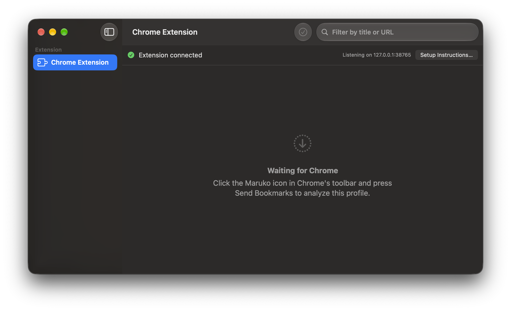

# Maruko

Format and move your browser bookmarks.

Maruko is a macOS app that cleans up bookmarks in the browsers you already use. It works together with a small companion Chrome extension: Maruko analyzes your bookmarks and previews the cleanup, the extension applies the change through Chrome's own `chrome.bookmarks` API. No exporting, no importing, and it works with Chrome running and Sync on, so the cleanup propagates to your other devices too.

